# Washing Machine Simulator — Visual Reference

> Đọc file này để nắm nhanh toàn bộ luồng hoạt động của project.
> Mỗi sơ đồ tập trung vào một khía cạnh cụ thể để dễ debug.

---

## 1. Kiến trúc tổng thể — Tasks & Communication Objects

Mô tả: **Ai** giao tiếp với **ai** thông qua **cơ chế nào**.

Hệ thống có ba luồng dữ liệu độc lập, đều hội tụ ở **WashingManager**. Mỗi luồng
một sơ đồ riêng để đọc cho dễ; chú giải màu dùng chung cho cả ba:

| Màu / hình | Loại đối tượng |
| --- | --- |
| 🟠 bầu dục | **ISR** — chạy trong ngắt, chỉ ghi vào queue rồi thoát |
| 🔵 hộp chữ nhật | **Task** |
| 🟢 hình trụ | **Queue** (FIFO, sao chép theo giá trị) |
| 🟣 hộp đôi | **Event Group** |
| ⚪ hình thoi nghiêng | **Software Timer** |
| ⬜ hộp xám | **Phần cứng** (nút bấm, LED, OLED) |

### 1a. Luồng lệnh người dùng — từ nút bấm tới màn hình

Nút bấm → ISR → `xButtonQueue` → UITask → `xCommandQueue` → WashingManager →
`xDisplayQueue` → OLEDTask → màn hình. UITask **không giữ trạng thái nào** và không
gửi gì tới OLED; WashingManager sở hữu con trỏ menu và là bên duy nhất dựng
`DisplayMsg_t`.

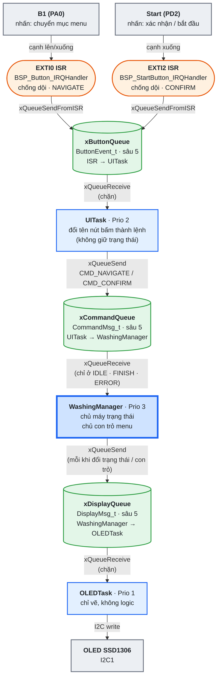

> **Lưu ý khi đọc:** WashingManager chỉ đọc `xCommandQueue` ở `IDLE`, `FINISH`,
> `ERROR`. Lúc đang chạy chu trình nó chờ trên event group (sơ đồ 1b), nên nút bấm
> trong thời gian đó bị bỏ qua — chủ ý thiết kế, xem START_HERE Tầng 3 §3.6.

### 1b. Luồng sự kiện hệ thống — cảm biến, timer và event group

SensorTask (định kỳ) và các Software Timer (khi hết giờ) **set bit** vào
`xSystemEvents`; WashingManager **chờ** đúng những bit có nghĩa ở trạng thái hiện
tại. WashingManager cũng là bên *khởi động* timer (trong entry-action của từng
trạng thái) và tự set `EVT_FINISHED` / `EVT_ERROR`.

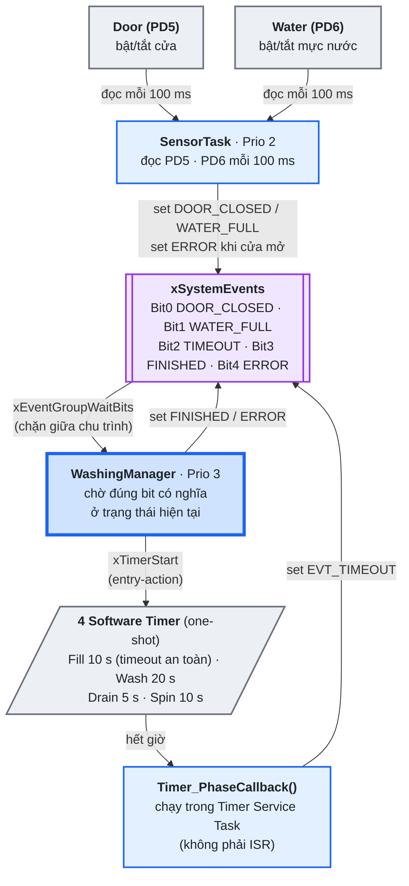

### 1c. Luồng điều khiển ngoại vi — WashingManager → BSP → chân GPIO

WashingManager **không bao giờ chạm HAL**: nó gọi các hàm `BSP_*`, lớp BSP mới biết
chân nào là chân nào. Đổi chân hay đổi phần cứng chỉ sửa trong `App/BSP/`.

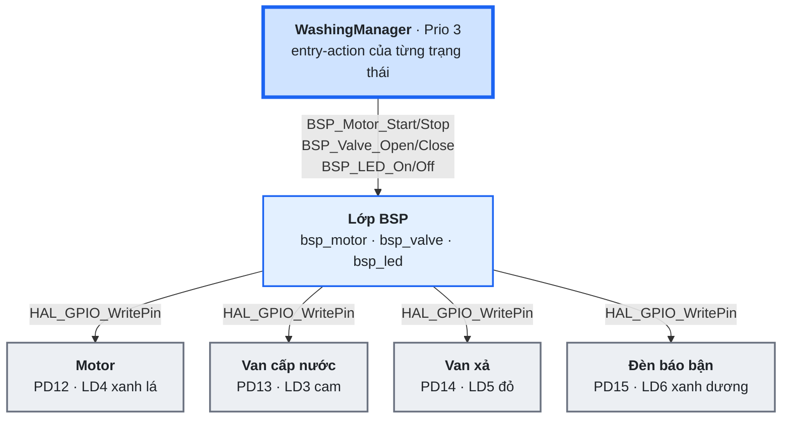

---

## 2. State Machine — Tất cả trạng thái và chuyển tiếp

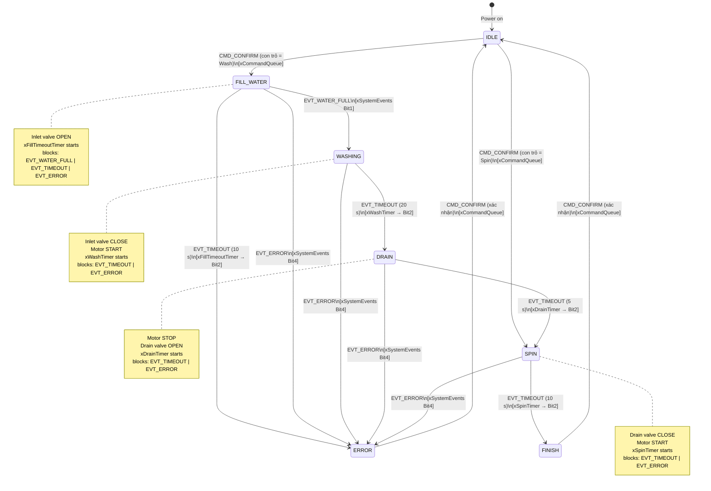

---

## 3. Kịch bản A — Full Wash Cycle (Bình thường)

**Trigger:** User nhấn PD2 (Start button) khi cursor ở "Wash"

> **Thứ tự "Render":** `xQueueSend` chỉ đưa OLEDTask (Prio 1) sang `Ready`; WashingManager (Prio 3) vẫn chạy tiếp cho tới khi tự block (`xQueueReceive` / `xEventGroupWaitBits`). Chỉ lúc đó OLEDTask mới được chạy và vẽ — nên trong sơ đồ, "Render" nằm **sau** dòng block của WashingManager.

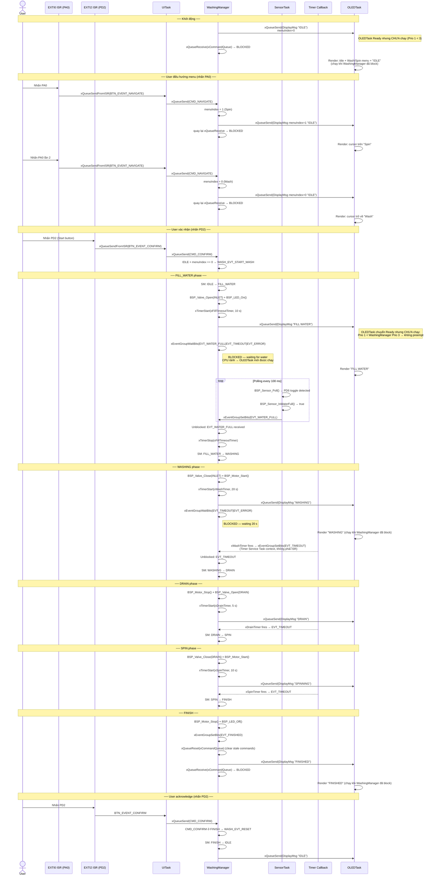

---

## 4. Kịch bản B — Spin-Only Cycle

**Trigger:** User nhấn PD2 (Start) khi cursor ở "Spin"

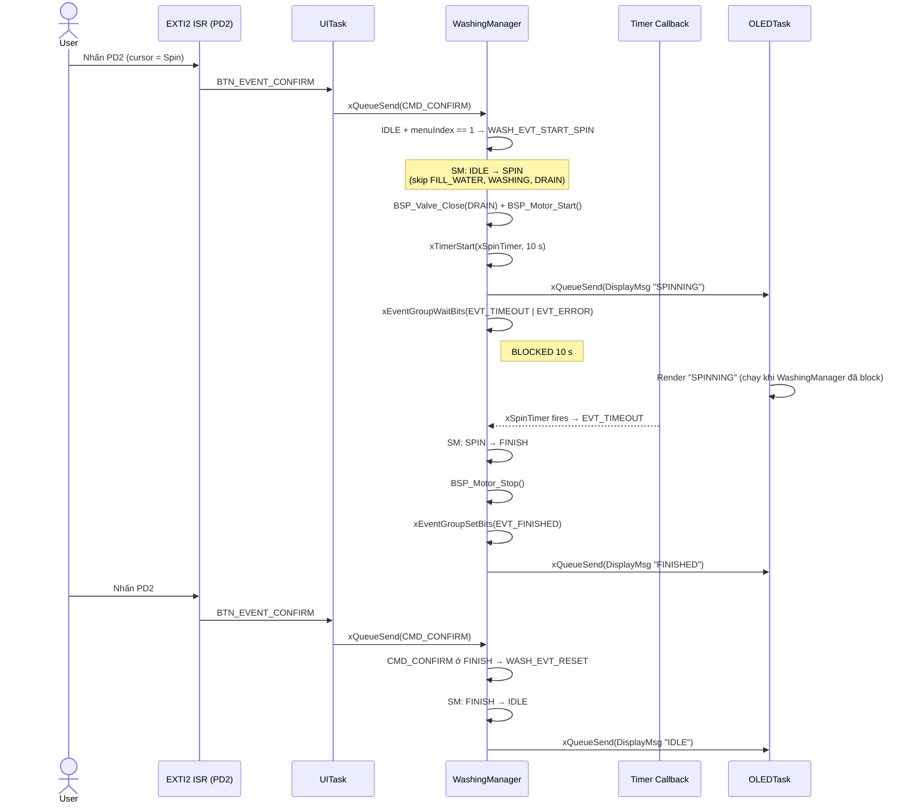

---

## 5. Kịch bản C — Error: Cửa Mở Giữa Chu Trình

**Trigger:** SensorTask phát hiện cửa mở khi đang chạy

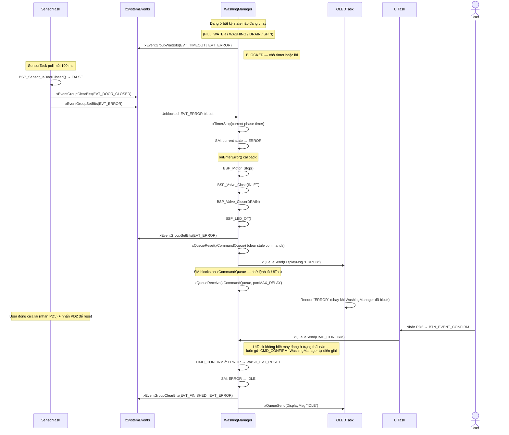

---

## 6. Kịch bản D — Fill Timeout (Nước Không Lên)

**Trigger:** Nước không đạt mức trong 10 giây

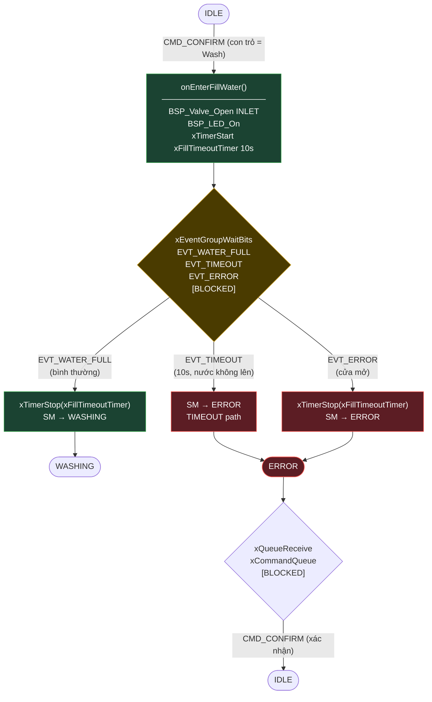

---

## 7. Button Press Flow — Từ Phần Cứng Đến State Machine

Cả hai nút dùng chung một cơ chế chống dội — **lọc theo khoảng lặng**: một cạnh chỉ
thành cử chỉ nếu đường tín hiệu đã im ít nhất `BUTTON_DEBOUNCE_MS` (50 ms) trước
đó, và **mọi cạnh** (kể cả cạnh bị bỏ) đều nạp lại đồng hồ im lặng. Cả hai nút bắn
sự kiện ngay lúc **nhấn**, không đợi thả tay. UITask chỉ đổi tên cử chỉ thành lệnh;
WashingManager giữ con trỏ và diễn giải lệnh.

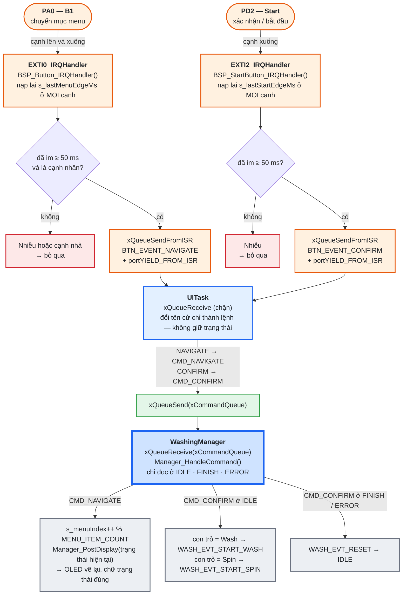

> **Giới hạn đã biết của PD2:** EXTI2 chỉ cấu hình cạnh xuống nên ISR không thấy cạnh
> nhả; một chùm dội lúc nhả vẫn có thể lọt thành một `CMD_CONFIRM` thừa. Chi tiết và
> cách khắc phục trong `App/BSP/Src/bsp_button.c`.

---

## 8. Software Timer Flow — Cách Timer Lái State Machine

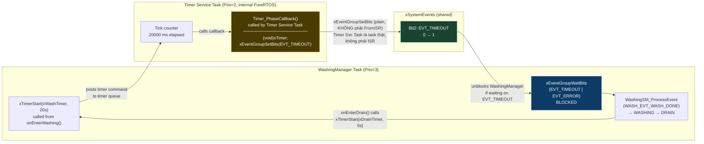

---

## 9. Task Blocking Map — Mỗi Task Đang Chờ Gì

Bảng này dùng để debug: nếu chương trình treo, xem task nào đang block và tại sao.

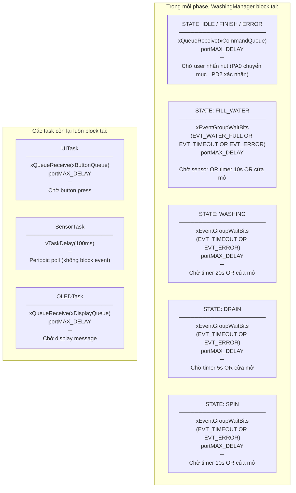

**Debug tip:** Nếu màn hình không update → OLEDTask đang chờ message ở xDisplayQueue. Kiểm tra WashingManager có gọi `Manager_PostDisplay()` không.

**Debug tip:** Nếu machine không start khi nhấn PD2 → kiểm tra theo thứ tự: (1) `Freertos.ioc`/`main.c` — `MX_GPIO_Init()` có `HAL_NVIC_EnableIRQ(EXTI2_IRQn)` với priority 5 không; (2) `EXTI2_IRQHandler()` trong `stm32f4xx_it.c` có thực sự gọi `BSP_StartButton_IRQHandler()` trong `USER CODE BEGIN EXTI2_IRQn 0` không (từng bị thiếu dòng này — xem [HARDWARE_BUGS.md § Bug #11](HARDWARE_BUGS.md#bug-11--pe1-startconfirm-chết-hoàn-toàn-quên-gọi-irq-handler)). GPIO/NVIC của PA0 và PD2 hiện do CubeMX generate hoàn toàn — không còn hàm `BSP_Button_Init()`/`BSP_StartButton_Init()` nữa; `ui_task.c` chỉ gọi `BSP_Button_RegisterCallback()`.

---

## 10. OLED Screen Layout

```
Pixel coordinates: x=0..127 (left→right), y=0..63 (top→bottom)
Font: 6×8 px per character → 21 chars/row, 8 rows max

┌────────────────────────────────────────────┐  y=0
│ (empty — always black)                     │  Rows 0–1 (y pixel 0–15)
├────────────────────────────────────────────┤  y=16
│   Washing Machine                          │  Row 2 (y pixel 16–23)
├────────────────────────────────────────────┤  y=24
│ > Wash    ← menuIndex == 0                 │  Row 3 (y pixel 24–31)
│   Wash    ← menuIndex != 0                 │
├────────────────────────────────────────────┤  y=32
│ > Spin    ← menuIndex == 1                 │  Row 4 (y pixel 32–39)
│   Spin    ← menuIndex != 1                 │
├────────────────────────────────────────────┤  y=40
│ IDLE / FILL WATER / WASHING /              │  Row 5 (y pixel 40–47)
│ DRAIN / SPINNING / FINISHED / ERROR        │
├────────────────────────────────────────────┤  y=48
│ (empty — always black)                     │  Rows 6–7 (y pixel 48–63)
└────────────────────────────────────────────┘  y=63

Owner phân quyền:
  Row 2: hardcoded trong oled_task.c
  Row 3–4: menuIndex từ DisplayMsg_t (owner: WashingManager — con trỏ menu)
  Row 5: statusText từ DisplayMsg_t (owner: WashingManager)
```

---

## 11. FreeRTOS Object Summary

| Object | Type | Depth/Bits | Producer | Consumer | Mechanism |
|--------|------|-----------|----------|----------|-----------|
| `xButtonQueue` | Queue | 5 items | ISR EXTI0 (PA0) + ISR EXTI2 (PD2) | UITask | `xQueueSendFromISR` / `xQueueReceive` |
| `xCommandQueue` | Queue | 5 items | UITask | WashingManager | `xQueueSend` / `xQueueReceive` |
| `xDisplayQueue` | Queue | 5 items | WashingManager (duy nhất) | OLEDTask | `xQueueSend` / `xQueueReceive` |
| `xSystemEvents` | Event Group | 5 bits | SensorTask, TimerCb, WashMgr | WashingManager | `xEventGroupSetBits` / `xEventGroupWaitBits` |
| `xFillTimeoutTimer` | SW Timer | One-shot 10 s (timeout an toàn) | WashingManager | TimerServiceTask | `xTimerStart` / callback |
| `xWashTimer` | SW Timer | One-shot 20 s | WashingManager | TimerServiceTask | `xTimerStart` / callback |
| `xDrainTimer` | SW Timer | One-shot 5 s | WashingManager | TimerServiceTask | `xTimerStart` / callback |
| `xSpinTimer` | SW Timer | One-shot 10 s | WashingManager | TimerServiceTask | `xTimerStart` / callback |

**Không có Mutex/Semaphore trong project hiện tại:**
- OLED access: chỉ có OLEDTask mới gọi BSP_OLED_* → không cần mutex
- State machine: chỉ có WashingManager mới gọi WashingSM_* → không cần mutex
- Sensor data: SensorTask write, WashingManager read qua Event Group (atomic) → không cần mutex
